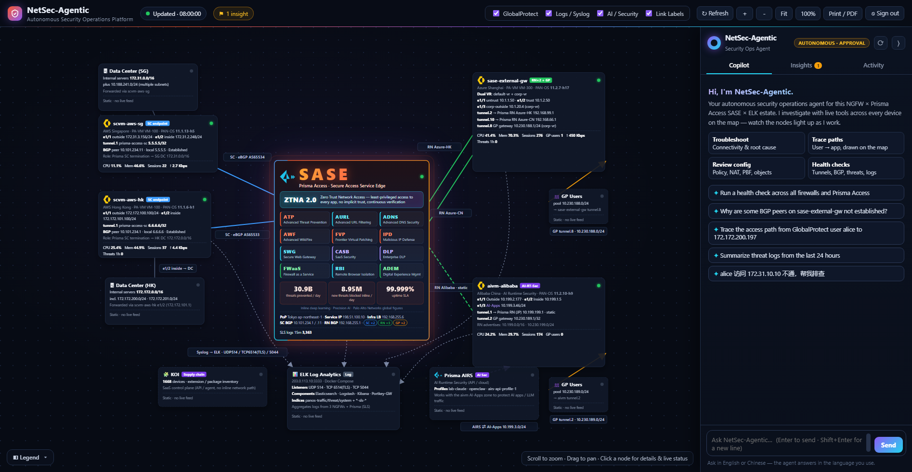
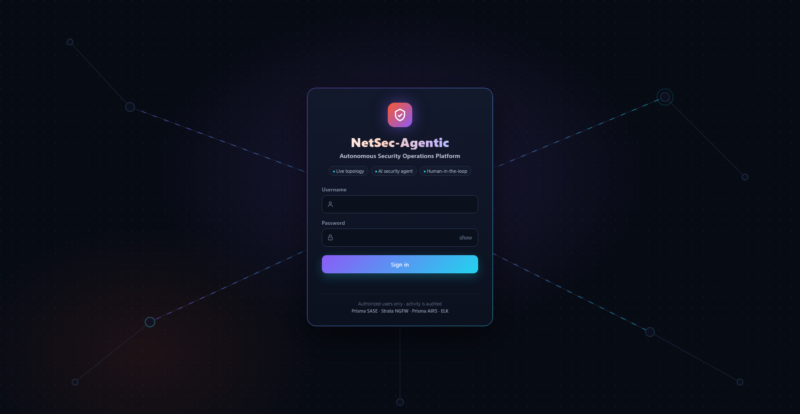
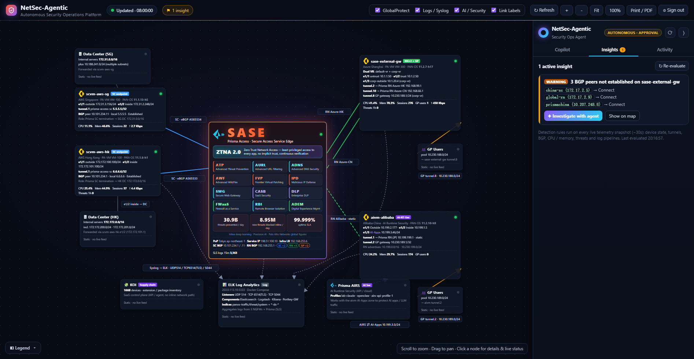

# NetSec-Agentic · Autonomous Security Operations Platform

> 中文版: [README.zh-CN.md](README.zh-CN.md) · Disclaimer: [NOTICE.md](NOTICE.md)

An AI security-operations agent for **Palo Alto Networks** environments: Strata NGFW, Prisma Access (SASE), Strata Cloud Manager, Prisma AIRS, plus a central ELK log platform. It comes with a **live topology**, real-time device and tunnel health, and a **Copilot** that troubleshoots by querying the firewalls, Prisma Access and the logs directly, returning the root cause **with evidence**.

This repository is the **working reference implementation**, running in a Palo Alto Networks lab. It was built end to end with Claude ("vibe-coded"). Everything specific to that lab has been removed or replaced with placeholders (see [NOTICE.md](NOTICE.md)), so you can launch the same agent in **your own** environment.



| Sign-in | Insights → one-click investigation |
|---|---|
|  |  |

## The problem it solves, and who it's for

When a user says *"I can't reach this app"*, the answer in a modern PANW estate is scattered across firewall consoles, CLIs, Prisma Access and millions of log lines. NetSec-Agentic brings that into one place and lets an agent do the evidence-gathering:

- **Customers' security and network operations teams:** answers in minutes instead of hours, in English or Chinese, with human approval before any configuration change.
- **Technical teams (SE / TS / labs):** a live, self-explaining environment for demos, enablement and testing.

## What's inside

| Capability | How it works |
|---|---|
| **Live topology** | `topo/`: page + collector polling every NGFW's XML API and ELK every 30 s: LEDs, CPU / mem / sessions, tunnels, BGP, threats |
| **Copilot** | `netsec-agent/`: Claude Agent SDK; the agent uses **MCP servers only**: `scm` (this repo, `src/`), PAN-OS ×N, ELK, KOI, Prisma AIRS. Its trace is shown step by step, devices light up on the map, and traced paths are drawn on it |
| **Insights** | detection rules on every snapshot (device / tunnel / BGP / resources / threats / log pipeline); one click hands a finding to the agent |
| **Guardrails** | `AGENT_MODE=readonly` blocks writes. `autonomous` + **human approval**: every config change waits for Approve / Reject. Built-in shell / file tools are disabled, and every tool call goes to an audit trail |
| **Language** | answers in the language of the question (English ↔ Chinese) |
| **Login** | server-side session login in front of the page and the `/api` proxy |
| **One-click restore** | `setup.sh` / `setup.ps1` (MCP servers on a workstation), `deploy/deploy-platform.sh` (platform on a server), `secrets/` (encrypted credential bundle tooling) |

```
Browser ──► topo :8080  (login gate · topology page · status collector · /api reverse proxy)
              │                          └── polls ► NGFW XML API ×N, Elasticsearch
              ▼
         netsec-agent :8081  (Claude Agent SDK · guardrails · approval · audit)
              │  MCP (stdio): scm · panos-* · elk · koi · prisma-airs
              ▼
         AWS Bedrock (or Anthropic API)            ELK (syslog from NGFWs + Prisma SLS)
```

---

## Option A: use the MCP servers with Claude Code (workstation)

Prerequisites: Git, Python 3.11+, Node.js 18+, Claude Code CLI (`claude`). On Windows, use Git Bash or PowerShell 5.1+.

```bash
git clone https://github.com/<your-org>/netsec-agentic.git && cd netsec-agentic
cp netsec-agent/secrets/agent.env.example my.env      # fill in YOUR tenant IDs, firewall IPs and API keys
bash setup.sh --from-env-file my.env                  # installs + registers all MCP servers
#   Windows PowerShell:  .\setup.ps1 -FromEnvFile my.env
claude mcp list                                       # all should show ✔ Connected
```

The scripts refuse to run while any value is still a `<placeholder>`. Create the PAN-OS API keys with `https://<firewall>/api/?type=keygen&user=<user>&password=<password>`, ideally for a **read-only** admin role.

## Option B: run the full platform on a Linux server

Prerequisites: Docker + Docker Compose, network reachability to your firewalls' management interfaces, and a Bedrock (or Anthropic) model endpoint.

1. **ELK** (log platform and the shared Docker network `elk_elk`): follow [elk/README.md](elk/README.md).
2. **Topology + login + proxy** (`/opt/topo`):
   ```bash
   cp -r topo /opt/topo && cd /opt/topo
   cp secrets/topo.env.example secrets/topo.env && chmod 600 secrets/topo.env   # fill in keys, hosts, TOPO_AUTH_PASS
   NETSEC_BIND_IP=<server-private-ip> docker compose -p topo up -d --build
   ```
3. **Agent** (`/opt/netsec-agent`): the image also needs this repo's `scm-mcp` package.
   ```bash
   cp -r netsec-agent /opt/netsec-agent && mkdir -p /opt/netsec-agent/scm-mcp /opt/netsec-agent/public /opt/netsec-agent/audit
   cp -r src pyproject.toml /opt/netsec-agent/scm-mcp/ && chown -R 1000:1000 /opt/netsec-agent/audit
   cd /opt/netsec-agent && cp secrets/agent.env.example secrets/agent.env && chmod 600 secrets/agent.env   # fill in
   NETSEC_BIND_IP=<server-private-ip> docker compose -p netsec-agent up -d --build
   ```
4. Open `http://<server-private-ip>:8080` and sign in (`TOPO_AUTH_USER` / `TOPO_AUTH_PASS`; if no password is set, a random one is printed in `docker logs topo`).
5. **Later updates / roll back to any version** from your workstation:
   ```bash
   NETSEC_HOST=<server> NETSEC_SSH_PORT=22 NETSEC_BIND_IP=<server-private-ip> TOPO_AUTH_PASS=<pw> \
     ./deploy/deploy-platform.sh --key <ssh-private-key>      # backup → upload → rebuild/restart → health check
   git checkout <tag> && ./deploy/deploy-platform.sh ...        # restore an earlier version
   ```

Keep the platform on a private network or behind a source-address allow-list. It serves plain HTTP, so put TLS in front for wider exposure. The reference `elk/docker-compose.yml` runs Elasticsearch without X-Pack security for a closed lab: enable authentication and bind ports to private addresses before using it elsewhere.

## Adapting it to your environment

This is a reference build for **one** lab (4 NGFWs, Prisma Access, ELK). To fit yours:

| What | Where |
|---|---|
| Your firewalls (names, hosts, keys) | `netsec-agent/agent/mcp.mjs` (`PANOS_HOSTS`), `topo/collector/app.py` (`DEVICES`), `setup.sh` / `setup.ps1` |
| Your topology drawing and node details | `topo/web/index.html` (node cards, wires, `DETAILS`), `topo/web/agent-chat.js` (`SERVER_NODE`) |
| The agent's knowledge of your network | `netsec-agent/agent/system-prompt.md` (topology, golden paths, known cases). Rewrite it for your estate; the lab version is kept as a worked example |
| Detection rules | `topo/web/agent-insights.js` |
| Read-only delivery pack for customers | [delivery/](delivery/) |

The operations guide [OPERATIONS.md](OPERATIONS.md) and the build log [netsec-agent/PROJECT-SUMMARY.md](netsec-agent/PROJECT-SUMMARY.md) document how the lab was built, run and debugged.

## Repository layout

| Path | Contents |
|---|---|
| `src/`, `pyproject.toml` | `scm-mcp`: the Strata Cloud Manager MCP server (Python, stdio) |
| `netsec-agent/` | Agent backend: `agent/server.mjs` (SSE API, approval, audit), `mcp.mjs`, `guard.mjs`, `system-prompt.md`, `elk-mcp/` |
| `topo/` | `collector/app.py` (status collector, login gate, `/api` proxy) and `web/` (topology, Copilot, Insights, Activity, login page) |
| `deploy/` | `deploy-platform.sh`: one-click deploy / restore to the server |
| `secrets/` | `seal.sh` / `unseal.sh` / `collect.sh`: keep **your** credentials in one encrypted bundle ([secrets/README.md](secrets/README.md)) |
| `elk/` | ELK configuration and rebuild guide |
| `delivery/` | Read-only customer delivery pack (Chinese) |
| `setup.sh`, `setup.ps1` | MCP one-click install / restore |
| `OPERATIONS.md` | Operations guide of the reference lab (English) · [中文](OPERATIONS.zh-CN.md) |
