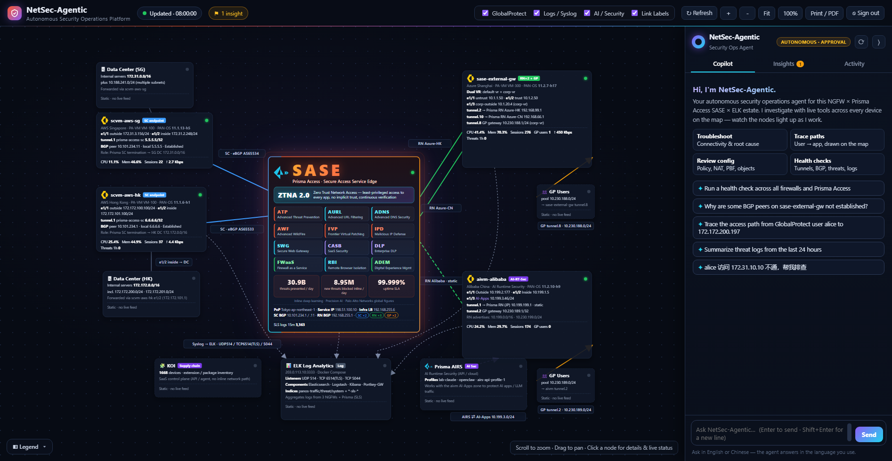

# NetSec-Agentic · 自主安全运营平台

> English: [README.md](README.md) · 免责声明：[NOTICE.md](NOTICE.md)

面向 **Palo Alto Networks** 环境（Strata NGFW、Prisma Access SASE、Strata Cloud Manager、Prisma AIRS，加集中 ELK 日志平台）的 AI 安全运营智能体：**实时拓扑**、设备与隧道实时健康状态，以及一个直接查询防火墙、Prisma Access 和日志、给出**带证据根因**的 **Copilot**。

本仓库是在 Palo Alto Networks 实验室中实际运行的**参考实现**，全程用 Claude 构建（vibe-coded）。所有实验室专属信息（密钥、证书、公网 IP、租户 ID、设备序列号、人名、密码）均已移除或替换为占位符（见 [NOTICE.md](NOTICE.md)），你可以在**自己的**环境里部署同样的智能体。



## 解决什么问题、给谁用

用户说"我访问不了这个应用"时，答案散落在防火墙控制台、命令行、Prisma Access 和海量日志里。NetSec-Agentic 把它们汇聚到一处，由智能体完成取证：

- **客户的安全与网络运维团队**：中英文提问，几分钟得到答案；任何配置变更都需人工批准。
- **技术团队（SE / TS / 实验室）**：一个实时、能自我讲解的演示、赋能与测试环境。

## 快速开始

**方式 A：在工作站上配合 Claude Code 使用 MCP**（需 Git、Python 3.11+、Node.js 18+、Claude Code CLI）

```bash
git clone https://github.com/<your-org>/netsec-agentic.git && cd netsec-agentic
cp netsec-agent/secrets/agent.env.example my.env      # 填入你自己的租户 ID、防火墙 IP、API Key
bash setup.sh --from-env-file my.env                  # 安装并注册全部 MCP Server
#   Windows PowerShell： .\setup.ps1 -FromEnvFile my.env
claude mcp list
```

**方式 B：在 Linux 服务器上运行完整平台**：步骤见英文 [README.md](README.md#option-b-run-the-full-platform-on-a-linux-server)（ELK → topo → netsec-agent，之后用 `deploy/deploy-platform.sh` 一键更新与回滚）。

## 适配你的环境

| 内容 | 位置 |
|---|---|
| 防火墙（名称、地址、密钥） | `netsec-agent/agent/mcp.mjs`、`topo/collector/app.py`、`setup.sh` / `setup.ps1` |
| 拓扑图与节点详情 | `topo/web/index.html`、`topo/web/agent-chat.js` |
| 智能体对你网络的知识 | `netsec-agent/agent/system-prompt.md`（实验室版本作为示例保留，请按你的环境改写） |
| 检测规则 | `topo/web/agent-insights.js` |
| 客户只读交付包 | [delivery/](delivery/) |

运营手册见 [OPERATIONS.zh-CN.md](OPERATIONS.zh-CN.md)，构建与排障全过程见 [netsec-agent/PROJECT-SUMMARY.md](netsec-agent/PROJECT-SUMMARY.md)。

平台请部署在内网或源地址白名单之后；平台为纯 HTTP，如需更大范围开放请在前面加 TLS。
